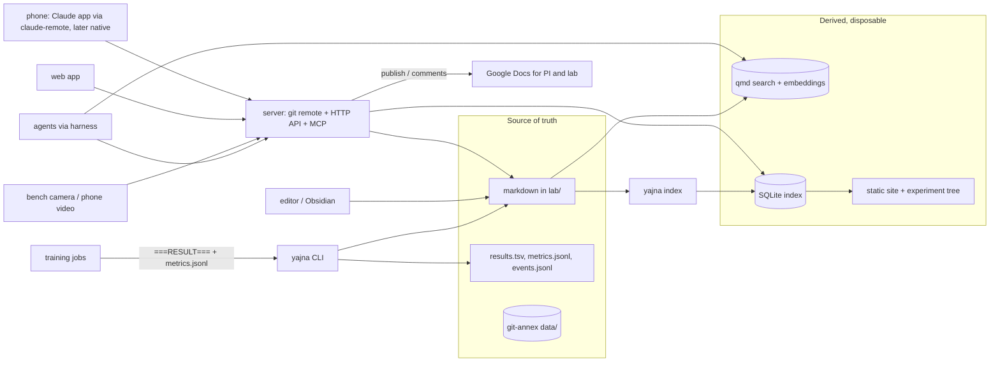

# Architecture: a system for capturing day-to-day lab work

Status: draft v0.5, 2026-10-15. This is a design discussion, not a spec. It lays out the
options, states a recommended path, and defines how the system is allowed to grow.
Decisions that get locked in should move to `docs/decisions/` as short decision records.

v0.2 revised v0.1 after reading every link in `context.md`. v0.3 added wet-lab planning
agents and live bench monitoring, and dropped the external task tracker. v0.4 added Google
Docs sync for collaboration with the PI and lab members. v0.5 adds hardware build projects
and revises the ID scheme for scale. See section 13.

## 1. Goals and constraints

From `context.md`, restated as design goals:

| ID | Goal |
|----|------|
| G1 | Capture both wet-lab and dry-lab daily work with as little friction as a paper notebook. |
| G2 | Plain markdown files are the source of truth. Specialized formats only where markdown genuinely cannot do the job. |
| G3 | The system evolves. New entity types, fields, and tools must be addable without rewriting history. |
| G4 | Agents are first-class users. They read the notebook as context for planning and, later, write to it while performing experiments. |
| G5 | Multiple clients over time: editor, CLI, web page, phone app, agents. All go through one backend eventually. |
| G6 | All tooling is built and deployed with Nix, via the `neusis` fleet repo. |

Non-goals for now: regulatory ELN compliance (audit trails for 21 CFR Part 11), replacing a
lab-wide inventory system such as Benchling, and real-time collaborative editing. The design
should not make these impossible, but it should not pay for them yet.

### 1.1 What the referenced work implies for the data model

Wet lab, from the four labs' publication and research pages:

- **Baum lab**: ESCRT-III driven division in Sulfolobus and Asgard archaea, nuclear envelope
  dynamics, division under confinement. Techniques: live-cell and super-resolution imaging,
  cryo-EM, cell mechanics measurements, comparative genomics. Implication: long time-lapse
  imaging sessions are the dominant artifact, and one imaging session feeds many analyses.
- **Chin lab and Constructive Bio**: genetic code expansion with orthogonal aminoacyl-tRNA
  synthetase and tRNA pairs, non-canonical amino acids (azides, alkynes, photocrosslinkers),
  quadruplet-decoding ribosomes, recoded genomes. Implication: many long-lived materials
  (strains, plasmids, synthetase variants, ncAA stocks) with versioned lineage, reused across
  experiments. Material provenance matters as much as experiment notes.
- **Elowitz lab**: synthetic gene circuits, cell-cell communication, MEMOIR lineage recording
  read out by spatial transcriptomics, cell fate control, single-cell dynamics in mammalian
  cells. Implication: time-lapse plus barcode and sequencing readouts, and circuit designs
  that are themselves versioned materials.
- **Blainey lab**: pooled optical CRISPR screens read by in situ sequencing, droplet
  microarrays for combinatorial screening, single-cell genomics, lab-on-chip automation.
  Implication: very large pooled datasets (millions of cells per screen), plate and
  library layouts as tabular data, and a natural fit for automation and agent-driven
  screening pipelines.

Dry lab:

- **AutoGo** (Eric Jang): a minimal Go-playing AI codebase whose stated purpose is studying
  how to automate the AI researcher. The repo's conventions are directly reusable here:
  one flat timestamped directory per experiment (`experiments/YYYY-MM-DD_HH-MM-slug/`)
  holding `README.md` (goal), the scripts, `results.tsv` (one row per run), figures, and
  `report.md` (findings). Runs emit a single `===RESULT===` JSON line. The `autoresearch`
  command is a keep-or-revert loop over one script and one metric. The tutorial's
  "experiment tree" view shows roughly ninety experiments grouped by theme, colored by
  outcome, with solid lines for the primary path and dotted lines for influence, which is
  exactly the graph the notebook should be able to render. Large data and checkpoints live
  on NFS, not in git.
- **Neural Mechanics** (Stanford): symmetry-derived conservation laws under gradient flow,
  broken by weight decay, momentum, and finite step size. Reproducing or extending it means
  logging per-layer quantities (parameter sums, per-filter norms, norm differences) at every
  step, not just scalar loss. Implication: the run telemetry format must handle per-tensor
  time series, not only scalars.
- **Interaction models** (Thinking Machines) and **Griffin** (Tavus): full-duplex, real-time
  human-agent interaction with sub-second micro-turns, copresence, and concurrent tool use.
  Implication for this system: the capture path should accept a continuous stream of
  timestamped events from an agent that is present at the bench or watching a training run,
  not just batched writes at the end. Agent sessions need to reference transcripts and media.

Hardware, from `context.md` and the kinds of tools the wet-lab work needs (bench camera
rigs, microfluidic controllers, incubation chambers, imaging adapters, liquid-handling
jigs):

- A build has design sources (CAD, PCB, firmware), a bill of materials with suppliers and
  lead times, revisions, assembly sessions, characterization and calibration tests, and once
  working it becomes equipment that bench run sheets book. Implication: builds need their own
  entity, parts are materials with supplier fields, assembly is a run sheet, and
  characterization is an ordinary experiment. Design sources should be text where possible
  (KiCad, code-based CAD) so they diff and build under Nix; binary exports go to the data store.

Common skeleton, shared by all of the above: a question, a plan, one or more runs, artifacts,
and a conclusion, with explicit outcome status and links to what influenced what.

## 2. The one principle everything hangs on

**Markdown is the write model. Everything else is a derived read model.**

Concretely:

1. Every fact the system knows is recoverable from the markdown files (plus referenced data
   files) in this repo. Delete every database, index, and website and they can be rebuilt.
2. Every writer, whether a human in an editor, the CLI, the backend server, or an agent, ends up
   producing a markdown change committed to git. There is no second write path that bypasses it.
3. Databases (SQLite index, search index, embeddings) are caches. They are never committed and
   never hand-edited.
4. Specialized formats are allowed for exactly four things:
   - **Binary instrument and model outputs** (images, `.fcs`, `.fastq`, checkpoints). Stored
     outside git history in a content-addressed store and referenced from markdown.
   - **High-frequency telemetry** (training metrics, per-layer statistics, sensor streams)
     as append-only JSONL, with Parquet or NPZ for per-tensor series. Markdown holds the
     summary, not the stream.
   - **Tabular data** that is naturally a table (plate maps, sgRNA libraries, sample sheets,
     AutoGo-style `results.tsv`) as CSV or TSV, linked from the markdown page.
   - **Derived indexes** (SQLite, embeddings, static site). Disposable.

One declared exception: a page can be marked as owned by a Google Doc (`sync: import`, see
5.8). For that page the markdown copy is derived. The exception is per page and visible in
frontmatter, never implicit.


## 3. Domain model

Entities. Each is a markdown file with YAML frontmatter, living in a predictable directory.

| Entity | ID prefix | What it is | Wet-lab example | Dry-lab example |
|--------|-----------|------------|-----------------|-----------------|
| Project | `PRJ` | A long-running line of inquiry. Has a status page. | "Archaeal division under confinement" | "Broken conservation laws in optimizers" |
| Experiment | `EXP` | A question with a plan, predictions, outcome, and a conclusion. Belongs to a project. | "Does ncAA X incorporate at site Y?" | "Does weight decay break the scale-symmetry invariant?" |
| Run | `RUN` | One execution of (part of) an experiment or build. `kind` is `bench`, `compute`, `assembly`, or `calibration`. Produces artifacts. | One bench session or one imaging session | One training job, one `results.tsv` row |
| Protocol | `PRO` | A reusable, versioned procedure. | Sulfolobus transformation v3 | Standard eval harness v2 |
| Material | `MAT` | A physical or digital thing that persists across experiments. `kind` includes `part` for hardware, with supplier and part number. | Strain, plasmid, synthetase variant, ncAA stock, sgRNA library, cell line, stepper driver, PTFE tubing | Dataset, base model, pretrained checkpoint |
| Artifact | `ART` | A data file or bundle produced by a run. Content-addressed. | Time-lapse stack, in situ sequencing images | Checkpoint, metrics JSONL |
| Analysis | `ANA` | A computation over artifacts, with code and result. | Segmentation plus ring-constriction timing | Conserved-quantity drift plot |
| Log entry | dated | A timestamped note. The daily journal. | "14:20 cells looked stressed, halved induction" | "Run 42 diverged at step 3k, suspect LR" |
| Task | none | A markdown checkbox on any page. The indexer collects them; there is no separate tracker. | "Order more IPTG" | "Re-run sweep with seed 3" |
| Equipment | `EQP` | An instrument with booking constraints and a calibration history. Either bought, or produced by a Build. | Spinning disk, flow cytometer, the bench camera rig from BLD-0003 | GPU node |
| Build | `BLD` | A physical tool being designed and built. Versioned by revision, has a BOM, assembly runs, and tests. Produces an `EQP` when it works. | Bench camera rig, microfluidic pressure controller, 3D-printed incubation chamber | Custom GPU node, sensor rig for a robot |
| Agent session | `AGS` | A record of an agent acting on the notebook: model, prompt, tools, outcome, transcript. | Agent that drafted a plate layout | Agent that ran an autoresearch loop |

Relationships:

```
Project 1--* Experiment 1--* Run 1--* Artifact
Experiment *--* Protocol         Run *--* Material (consumed / produced)
Experiment *--* Experiment       (influenced_by, the dotted lines in AutoGo's tree)
Analysis *--* Artifact            Log entry --> any entity (mentions)
Agent session --> any entity it created or edited
Project 1--* Build 1--* Run (assembly)   Build *--* Material (BOM)
Build 1--1 Equipment (produces)          Experiment --> Build (characterizes)
```

Deliberate choices:

- **Run is separate from Experiment.** Experiments are rare and curated; runs are frequent and
  mechanical. In an autoresearch loop an agent creates dozens of runs per night under one
  experiment. Keeping them apart stops the experiment page from drowning in run noise.
- **Experiments carry `outcome` and `influenced_by`.** AutoGo's experiment tree shows that
  the value of a research log is largely in the dead ends and in which earlier result
  motivated which later attempt. Both are explicit fields, not prose, so they can be rendered.
- **Material is shared between wet and dry.** A dataset and a plasmid are both "a thing with a
  provenance that gets reused". One schema with a `kind` field, not two entity types.
- **Log entries are the lowest-friction object.** No required fields beyond a timestamp.
  Structure is added later by linking them to entities, not demanded up front.

## 4. Repository layout and file conventions

```
yajna/
  context.md
  docs/
    architecture.md          # this file
    decisions/               # ADR-0001-*.md, short, dated
    conventions.md           # the "how to write an entry" cheat sheet
  schema/                    # JSON Schema for each entity's frontmatter, versioned
  templates/                 # one markdown template per entity
  .claude/                   # commands and skills for agents working in this repo
  lab/                       # the notebook proper (the "vault")
    projects/PRJ-0001-archaeal-division/
      README.md              # project status page: current belief, open questions
      experiments/
        EXP-0007-escrt-timing.md
        EXP-0007/            # experiment-local files (AutoGo style): scripts, results.tsv, figures/
      runs/RUN-20261014-7h2q.md       # for a bench session this is the run sheet (see 7.1)
      runs/RUN-20261014-7h2q/         # run-local small files: metrics.jsonl, plate.csv, events.jsonl
      analyses/ANA-0004.md
    protocols/PRO-0012-sulfolobus-transformation.md
    materials/MAT-0210-strain-xyz.md
    equipment/EQP-0003-spinning-disk.md
    builds/BLD-0003-bench-camera-rig.md
    log/2026/2026-10-14.md   # one file per day per author
    tasks.md                 # loose todos not tied to a page
    agents/AGS-000123.md
  data/                      # content-addressed large files (not in git history, see 5.3)
  thesis/                    # thesis source (typst or LaTeX)
  talks/                     # presentation sources
  projects/                  # code for dry-lab projects, each its own flake or subdir
  hardware/<name>/           # design sources per build: cad/, pcb/ (KiCad), firmware/, flake.nix
  tools/                     # the yajna CLI, indexer, server (may become its own repo)
  flake.nix
```

Frontmatter is mandatory on entity files and is the only structured part. The body is free
markdown. Example experiment:

```markdown
---
id: EXP-0007
type: experiment
schema_version: 1
title: Timing of ESCRT-III recruitment relative to chromosome segregation
project: PRJ-0001
status: active            # planned | active | paused | concluded | abandoned
outcome: null             # null | positive | negative | inconclusive | infra
influenced_by: [EXP-0003]
created: 2026-10-14
author: ank
protocols: [PRO-0012]
materials: [MAT-0210, MAT-0198]
tags: [imaging, sulfolobus]
---

## Question
...

## Hypothesis and predictions
If H1 is true we expect ... ; if false we expect ...

## Plan
1. ...

## Success criteria
Recruitment onset measurable in >= 20 cells with < 2 min uncertainty.

## Runs
Filled in by tooling: links to RUN-* pages, or a rendered view of results.tsv.

## Conclusion
Written once, by a human, when status becomes `concluded`.
```

Example daily log (`lab/log/2026/2026-10-14.md`). Entries are appended, never reordered:

```markdown
---
type: log
date: 2026-10-14
author: ank
schema_version: 1
---

- 09:10 Started induction for [[EXP-0007]] using [[MAT-0210]], 0.2 mM. #bench
- 11:45 Imaging on the spinning disk, 37C chamber took 20 min to equilibrate. -> [[RUN-20261014-7h2q]]
- 14:20 Cells look stressed at 0.2 mM. Halving next time. Note for [[PRO-0012]].
- 16:00 [agent:planner] Drafted plate layout for tomorrow, see [[AGS-000123]].
```

Dry-lab run convention, adopted from AutoGo with small changes:

- An `EXP-*/` directory holds the scripts, a `results.tsv` with one row per run, figures, and
  the agent-written `report.md`. The `EXP-*.md` page is the human-curated layer on top.
- Every run prints one `===RESULT===` JSON line. The CLI parses it into a `RUN` page and a
  `results.tsv` row. AutoGo leaves `results.tsv` untracked; here it is tracked, because it is
  small, textual, and the whole point of the notebook.
- Per-step telemetry (loss, and for Neural Mechanics style work the per-layer invariants)
  goes to `RUN-*/metrics.jsonl` or `metrics.parquet`, tracked via the data store (5.3) when
  large. The `RUN` page records the flake revision and the git commit of the script.

Protocol step convention. A `PRO` page is free markdown except for one section, `## Steps`,
which is an ordered list where each step is one item with an optional trailing attribute
block. This is the minimum structure that lets an agent instantiate a protocol into a run
sheet, compute a schedule, and later check a step on video:

```markdown
## Steps
1. Thaw [[MAT-0210]] on ice. {duration: 15m, materials: [MAT-0210], check: "tube on ice"}
2. Add 200 uL of buffer to each tube. {duration: 5m, materials: [MAT-0042], volume: 200uL}
3. Spin at 4000 g. {duration: 10m, equipment: [EQP-0007], hazard: "balance the rotor"}
4. Incubate at 37C. {duration: 2h, wait: true, equipment: [EQP-0002]}
```

Step IDs are `PRO-0012@3.s4`: protocol, version, step number. Versions are git history plus a
`version` field bumped on any step change, so a run sheet can pin the exact steps it ran.
Attributes are deliberately a small open set (`duration`, `wait`, `materials`, `equipment`,
`volume`, `temp`, `hazard`, `check`) validated by the schema; unknown keys are allowed and
ignored. The alternative, a YAML step list in frontmatter, is more structured but stops the
protocol reading like a protocol, which is the thing a tired person at the bench needs.

Protocols can also be written as code and rendered into this same step format. That
framework, modelled on the Opentrons Python API but with humans as the default executor,
is designed in `docs/protocol-framework.md`. A protocol page is either markdown-native
(hand-written steps) or code-native (generated steps); frontmatter says which.

Material inventory fields. `MAT` frontmatter gains `location` (freezer, rack, box, position),
`quantity`, `unit`, `concentration`, `lot`, `expires`, and `status` (`in_stock`, `low`,
`out`, `ordered`). These are what a planning agent resolves a material list against. They are
updated by the human or by a `yajna use MAT-0210 50uL` command that also writes a log entry.

Tasks. Any `- [ ]` checkbox on any page is a task. The indexer collects them with the page
and section they sit in, so `yajna tasks` lists open items across the vault and an agent can
claim one by checking it with a log entry. Loose todos go in `lab/tasks.md`. There is no
separate tracker.

Conventions worth fixing early because they are painful to change later:

- **IDs are stable and prefixed; the ID is the key.** Human-readable slugs in filenames are
  decoration. Renaming a file never breaks a link. If a project moves to its own repo, its
  IDs move with it unchanged. Two shapes, chosen by how an entity gets created:
  - *Curated entities* (`PRJ`, `EXP`, `PRO`, `MAT`, `EQP`, `BLD`, `ANA`) are created rarely,
    by a human or a reviewed agent, through the CLI: `EXP-0042`. Four digits of padding is
    for `ls` ordering only; the parser accepts any length, so `EXP-10000` is valid and only
    sorts wrong in a plain directory listing. Allocation is a counter in the repo; a collision
    between two offline machines shows up as a git conflict on the counter file and is fixed
    by hand, which is acceptable at a few hundred per year.
  - *Volume entities* (`RUN`, `AGS`, `ART`) are created by machines, often many per hour on
    several hosts at once, so a shared counter does not work: `RUN-20261015-k7f3`, the UTC
    date plus four random base32 characters. Sortable by day, collision-free without
    coordination, and the date tells a reader when it happened. `ART` additionally carries
    its content hash, which is the real identity.
- **Links use `[[ID]]` syntax**, optionally `[[ID|display text]]`. The indexer resolves them.
  Obsidian-compatible, so Obsidian works as an editor without being a dependency.
- **One log file per day per author.** This is what keeps git merges trivial when the phone,
  the laptop, and an agent all append on the same day.
- **Timestamps are ISO 8601 with timezone** in frontmatter. Log lines use local `HH:MM`
  because the day file fixes the date and the author's timezone.
- **`schema_version` on every file.** See section 10.

## 5. Options considered

### 5.1 How to organize notes

| Option | Pros | Cons |
|--------|------|------|
| Daily journal only (classic paper notebook) | Zero friction, chronological, never stale. | Finding "everything about strain X" needs search; no place for a curated conclusion. |
| Per-experiment pages only (AutoGo's model) | Structured, agent-friendly, good for the thesis. Works for AutoGo because every experiment is code. | Friction kills it on busy bench days. Mid-day observations get lost. |
| **Both, with explicit links (recommended)** | Journal captures, experiment pages curate. The indexer joins them. | Two places to look. Mitigated by a derived "experiment timeline" view that inlines log entries mentioning the experiment. |

### 5.2 Where structured metadata lives

| Option | Verdict |
|--------|---------|
| **YAML frontmatter, validated by JSON Schema (recommended)** | Standard, readable, every tool supports it, and `qmd` indexes it. Schemas live in `schema/` and version with the repo. |
| Inline tags only (`#status/active`) | Too weak for typed fields like dates and lists. Use tags for ad-hoc labelling only. |
| Sidecar JSON per file | Splits the truth across two files. Rejected. |
| Dataview-style inline fields (`status:: active`) | Obsidian-specific. Rejected. |

### 5.3 Large data: where artifacts live

Imaging data alone will be terabytes; a pooled optical screen is millions of cells. AutoGo's
answer is NFS and a manifest of relative paths. That works on one cluster but gives no
content addressing and no way to know which bytes a page refers to once files move. Options:

| Option | Pros | Cons |
|--------|------|------|
| Plain NFS plus path manifests (AutoGo) | Zero tooling. | Paths rot, no integrity check, no partial sync to a laptop. |
| Git LFS | Simplest mental model. | Single remote, poor at TB scale, weak offline story. |
| DVC | Designed for ML, nice pipelines, S3 and local backends. | Second metadata layer (`.dvc` files), pipeline features overlap with Nix. |
| **git-annex (recommended)** | Content-addressed, many remotes at once (LMB storage, NFS, laptop, S3), partial checkouts, in nixpkgs, handles TB scale, works for imaging and checkpoints alike. | Learning curve; symlink mode is awkward on macOS (use unlocked files). |

Recommendation: git-annex under `data/`, with `ART` pages recording the annex key (a content
hash) in frontmatter. The `ART` page is the stable handle; bytes can move between remotes
without touching markdown. NFS or LMB storage becomes one annex remote, so the AutoGo-style
cluster workflow still works. Confirm once the LMB storage situation is known (section 12).

Hardware design sources follow the same split. Text sources (KiCad schematics and boards,
code-based CAD such as CadQuery or OpenSCAD, firmware) live in git under `hardware/`.
Binary exports and inputs (STEP, STL, Gerber zips, datasheets, photos of the build) are
`ART` entries in the annex, each recording the source commit it was generated from.

### 5.4 Search and the derived index

Your `neusis` agent harness already installs `qmd`, a local markdown search tool with BM25,
embeddings, and a scheduled reindex (`qmd-reindex` module, hourly). That changes the plan:

| Option | Verdict |
|--------|---------|
| None, just `grep` and the editor | Fine for month one. Not enough for agents or a web UI. |
| **`qmd` for full-text and semantic search (recommended)** | Already deployed on your machines, already an MCP server for agents, reindexes on a schedule. Nothing to build. Point it at `lab/`. |
| **Small SQLite index built by `yajna index` for structured queries (recommended, Phase 1)** | `qmd` answers "find pages about X". It does not answer "all runs of EXP-0007 ordered by metric" or "materials consumed by runs in September". A thin indexer over frontmatter and `[[links]]` does, and it is what the site and the experiment tree render from. |
| Postgres | Only if the server ever has concurrent writers. SQLite can be swapped because nothing depends on it being the truth. |

The indexer parses every markdown file, validates frontmatter against the schema, resolves
`[[links]]`, and emits tables: `entity`, `link`, `log_entry`, `mention`, `run_result`.
Validation failures are build failures. The same indexer runs in CI via `nix flake check`.

### 5.5 Existing tools

- **Obsidian**: compatible as an editor since the vault is just `lab/`. Not a dependency.
- **eLabFTW, LabArchives, Benchling**: real ELNs with inventory and compliance. They own the
  data in their database, which violates G2. If the lab mandates one, treat it as an export
  target, not the source of truth. No sync with Benchling is planned. We may occasionally
  want to import from it: notebook entries come out of the API with full body content
  (dated days and typed note parts), and plasmids come out as GenBank from the API or the
  UI. That would be a one-off `yajna import benchling` command writing ordinary pages and
  `.gb` files, not a sync mode. API access depends on the tenant having the Developer
  Platform capability; the UI export of GenBank files works regardless.
- **Notion**: same problem. An exporter could publish project status pages there for others.
- **Weights & Biases, MLflow**: good dashboards. Keep metrics as local JSONL (the truth) and
  optionally mirror to W&B for live viewing. Never make W&B the only copy.
- **Jupyter**: notebooks are code, not notes. They live under `projects/` and an `ANA` page
  links to them. Use `jupytext` paired `.py` files so diffs are readable.

### 5.6 How the backend writes

| Option | Verdict |
|--------|---------|
| **Server owns a git checkout and commits markdown (recommended)** | One write path, offline-capable clients, history for free, agents and humans are symmetric. |
| Server owns a database and exports markdown | Markdown becomes a view, not the truth. Violates G2. |
| Server appends to an event log, markdown is materialized | Right for telemetry streams and for the real-time agent events implied by interaction models, wrong for notes. Use the event log only for `RUN-*/metrics.jsonl` and agent session event streams, and summarize into markdown. |

"Git is the API" is the short version. The server is a git remote with a brain.

### 5.7 Tasks

| Option | Verdict |
|--------|---------|
| **Markdown checkboxes, collected by the indexer (recommended)** | Tasks live next to the thing they are about: a run sheet step, an experiment's plan, a material that needs reordering. Addressing is page plus section plus position, good enough because checklists are short-lived. Dependencies are expressed by ordering within a run sheet, which is where they actually matter. |
| A git-native issue tracker | Tried with `beads`; being deprecated because it did not work well enough. Dropped. |
| Linear or similar | External truth. Rejected for the same reason as ELNs. |

### 5.8 Collaboration: syncing pages to Google Docs

The PI and lab members will not read markdown in a git repo. They will read and comment on a
Google Doc. The requirement is that a chosen subset of pages appears in Google Docs, stays
current, and that their feedback comes back into the notebook. One direction is easy; the
other needs care; so sync is a per-page mode, not a global switch.

| Mode | Direction | What happens | Use for |
|------|-----------|--------------|---------|
| **`publish` (default for shared pages)** | markdown to doc; comments back | Page is rendered and the doc updated in place. Comments and replies are pulled into the repo. | Project status pages, experiment conclusions, protocols, thesis chapters |
| `mirror` | both ways, last writer wins | As `publish`, plus edits made in the doc are exported, normalized, diffed, and committed under the editor's email. | A few pages the PI edits directly |
| `import` | doc to markdown only | The doc is the truth; the markdown copy is derived and read-only in the repo. | Documents the PI owns, such as a grant or paper draft |

Mechanics:

- Frontmatter gains `sync: {provider: gdoc, mode: publish, doc_id: <id>}`. The doc ID is
  allocated on first publish and never changes, so the URL and sharing settings persist and
  collaborators bookmark it once.
- Rendering: markdown to Google Doc via the Drive API, uploading HTML or docx with conversion,
  or the native Markdown import Google Docs now supports. Wikilinks render as links to the
  sibling doc when that page is also synced, otherwise to the static site. Frontmatter is
  not rendered; a small header block shows the ID, status, and last-updated date.
- Comments: the Drive API exposes comments and replies with their anchor text. The sync job
  writes them into the page under a `## Review` section (or as log entries tagged with the
  commenter) and marks them resolved in the doc when the corresponding checkbox is ticked in
  the repo. This is the main payoff: feedback from people who never open the repo lands where
  agents and the human can both see it.
- Two-way (`mirror`): export the doc as Markdown or docx, run it through pandoc for a
  canonical form, keep the frontmatter block from the repo untouched and replace only the
  body, diff, and commit as `author: gdoc:<email>`. Pull comments before every overwrite,
  because replacing a doc's body orphans existing comment anchors. Conflicts resolve as last
  writer wins per page; git history makes any loss recoverable.
- Where it runs: `yajna sync` from the laptop in Phase 1, then on the server after each push
  and on a schedule once the server exists. Credentials are a service account or OAuth token
  kept in `neusis` secrets.

Why not the alternatives:

| Option | Verdict |
|--------|---------|
| Share the static site | Still the right thing for you and for agents, but a link to a website is not "a doc I can comment on" for a non-technical reader. Keep it; it is not the collaboration channel. |
| Notion or Confluence | Same sync problem with a tool the lab does not already use. |
| Full two-way sync for every page | Lossy round trips on frontmatter, wikilinks, tables, and attribute blocks on protocol steps. Restrict `mirror` to pages that are mostly prose. |
| PDF exports in a shared Drive folder | No comments back. Fine as a fallback for read-only material like talks. |

## 6. System components



Components, in the order they will exist:

1. **Conventions, schemas, templates, `.claude/commands`.** Pure files. Usable with any
   editor on day one. The commands directory mirrors AutoGo's `experiment` and
   `autoresearch` commands, adapted to write `EXP` and `RUN` pages.
2. **`yajna` CLI.** `new <type>`, `log "text"`, `result` (parse a `===RESULT===` line into a
   run), `validate`, `index`, `show <ID>`, `timeline <ID>`, `tree <PRJ>`. Allocates IDs, fills
   templates, runs the indexer. The CLI is what agents call before there is a server.
3. **Search.** `qmd` pointed at `lab/`, via the existing `qmd-reindex` module. No code.
4. **Indexer.** Library plus command. Markdown in, SQLite out. Owns link resolution and
   schema validation. Everything downstream reads SQLite, never markdown directly.
5. **Static site.** Rendered from the index: project pages, experiment timelines, the
   AutoGo-style experiment tree (themes as rows, outcome as color, `influenced_by` as dotted
   edges), material usage, search box backed by `qmd`. No backend needed.
   Alongside it, `yajna sync` publishes pages marked for Google Docs and pulls comments back
   (5.8). Also no backend needed; it moves to the server when one exists.
6. **Server.** A single service that is a git remote, runs the indexer on push, exposes an
   HTTP API for writes (`POST /log`, `POST /runs/{id}/metrics`, `POST /entities`) and reads
   (`GET /search`, `GET /entities/{id}`, `GET /timeline/{id}`), and exposes the same operations
   as an MCP server for agents. Token auth per client. Deployed as a NixOS module from `neusis`.
7. **Agent layer.** See section 7.
8. **Web and phone apps.** Thin clients over the server API. Phone focuses on capture: text,
   voice, photo of a gel or a plate. Web focuses on reading, reviewing agent changes, editing.

Language: the file formats and the SQLite schema are the contract, so implementation language
is swappable. Start with Python for the CLI and indexer because the dry-lab code and agent
tooling are Python. Revisit for the server when it exists.

## 7. Agent integration

Agents interact in three modes, and the design supports them in this order.

**Reading (context for planning).** Agents should not be handed the whole repo. They get:
`qmd` search for "what do we know about X", and the server's structured tools `get(ID)`,
`timeline(ID)` (entity plus every log entry mentioning it), `tree(PRJ)` (experiments with
outcomes and influence), `open_tasks(PRJ)` from the checkbox index, `protocol(ID, version)`, and
`related(ID)` via the link graph, `inventory(MAT...)` for stock and location. Project `README.md` pages are written to be the first
thing an agent reads: current belief, open questions, what not to try again. AutoGo's
lesson is that the experiment tree with outcomes is the single most useful context object.

**Writing (recording).** Agents write through the same CLI or API as the phone app. Every
write carries `author: agent:<name>` and an `AGS` session ID that links to the model, the
prompt, the tool calls, the transcript, and the resulting commit. Rules:

- Log entries, new `RUN` pages, `results.tsv` rows, and `report.md` land directly.
- Edits to `EXP`, `PRO`, and `MAT` pages, and the `Conclusion` section specifically, land on
  a branch (or with `review: pending` in frontmatter) and show up in the web UI for human
  approval. The notebook is also the thesis evidence, so curated pages stay human-signed.
- Agents never delete. Git history is the safety net anyway, but the API simply has no delete.

**Performing experiments.** Dry lab first, copying AutoGo's `autoresearch` loop: an agent
creates an `EXP` draft with a target metric, iterates on one script, each run emits
`===RESULT===`, the CLI records a `RUN` and a `results.tsv` row, the agent keeps or reverts,
and at the end writes `report.md` and a proposed conclusion. The human's job is interactive
interpretation, which is also how AutoGo describes the division of labour. Wet lab is the
subject of 7.1 and 7.2.

### 7.1 Wet-lab planning agents

The goal: an agent designs a bench experiment and hands over a material list, a protocol
sheet with a checklist, and a step-by-step schedule. The design supports this once protocols
have structured steps and materials have inventory fields (section 4). The output is a
**run sheet**, which is simply a `RUN` page for a planned bench session:

```markdown
---
id: RUN-20261014-7h2q
type: run
kind: bench
experiment: EXP-0007
protocols: [PRO-0012@3, PRO-0019@1]
planned_start: 2026-10-16T09:00:00+01:00
status: planned          # planned | in_progress | done | aborted
author: agent:planner
session: AGS-000123
review: pending
---

## Materials
| Material | Need | In stock | Location | Action |
|----------|------|----------|----------|--------|
| [[MAT-0210]] strain xyz | 1 vial | 3 | F-80 R2 B4 p12 | |
| [[MAT-0042]] buffer A | 2 mL | 0.5 mL | bench 3 | - [ ] make 10 mL fresh, [[PRO-0005]] |
| [[MAT-0198]] ncAA stock | 20 uL | out | | - [ ] order, 3 day lead time |

## Schedule
| Time | Step | Duration | Notes |
|------|------|----------|-------|
| 09:00 | PRO-0012@3.s1 thaw | 15m | |
| 09:15 | PRO-0012@3.s2 buffer | 5m | |
| 09:20 | PRO-0012@3.s3 spin | 10m | [[EQP-0007]] booked 09:15-09:45 |
| 09:30 | PRO-0012@3.s4 incubate | 2h wait | start [[PRO-0019]] in parallel |
| 11:30 | ... | | |

## Checklist
- [ ] PRO-0012@3.s1 Thaw [[MAT-0210]] on ice
- [ ] PRO-0012@3.s2 Add 200 uL buffer A to each tube
- [ ] PRO-0012@3.s3 Spin 4000 g 10 min. Balance the rotor.
- [ ] PRO-0012@3.s4 Incubate 37C 2 h
```

How the agent produces it:

1. Reads the `EXP` page (question, predictions, success criteria), the project README, the
   experiment tree, and prior run sheets for the same protocols including their actual
   timings and the log entries that mention problems.
2. Picks and instantiates protocols: concrete volumes and counts from the experiment's
   sample plan, every step addressed by its stable step ID.
3. Resolves the material list against inventory, and turns shortfalls into checkbox tasks
   on the run sheet (make fresh, order, borrow).
4. Computes the schedule from step durations, `wait` steps that allow interleaving a second
   protocol, and `EQP` availability. Exporting the schedule to a calendar is a later nicety.
5. Writes the run sheet with `review: pending`. The human edits and approves it on the phone
   or in the editor. Approval flips `status: planned`.

Execution: the checklist is the live state of the session. Ticking a step on the phone (or
saying it to a listening agent) appends an event to `RUN-20261014-7h2q/events.jsonl` with the step ID
and timestamp and checks the box. At the end the `RUN` page gets actual timings next to planned
ones, and deviations become log entries. Over time this gives the planner real durations per
step, which is what makes the schedules trustworthy.

What this requires that v0.2 did not have: the protocol step convention, material inventory
fields, the optional `EQP` entity, `kind: bench` runs with `events.jsonl`, and an agent
command (`.claude/commands/plan-bench.md`) that encodes the five steps above.

### 7.2 Live bench monitoring

The later goal: stream video of the bench session and have an agent check in real time that
nothing is going wrong. The run sheet makes this tractable, because the agent does not have to
understand lab work in general. It has to compare what it sees against one known step at a
time.

Pipeline:

```
camera (phone or fixed bench camera)
  -> stream to the server (WebRTC or RTSP, over Tailscale)
  -> watcher agent session (AGS) with context: run sheet, current step, step attributes
  -> verdicts as events in RUN-*/events.jsonl, alerts to phone, voice, or screen
  -> video kept as ART (full session or clips around alerts), referenced by time range
```

Two implementation levels, in order:

- **Sampled frames (first version).** Every few seconds a frame, plus the current step and
  its `check` and `hazard` attributes, goes to a vision model. It answers a narrow question:
  is the expected action happening, is a hazard condition violated, has the step's `check`
  been satisfied. Coarse things are checkable this way: which tube or box, pipette in hand,
  rotor balanced, gloves on, ice present, step order, elapsed time against `duration`. Fine
  quantities (200 versus 250 uL) are not reliably checkable from video and should not be
  promised. The step's `check` field is where the protocol author states what is actually
  visible.
- **Full-duplex copresence (later).** The interaction-model direction: continuous audio and
  video micro-turns, interjections mid-action, timers announced aloud, the checklist ticked by
  voice. Same data model, different transport, which is why the event-log exception in 5.6
  exists.

What this requires from the system: step-level ground truth in machine-readable form (the
step convention), a state machine for "current step" (the checklist plus `events.jsonl`),
sub-second event timestamps, `AGS` sessions that reference video `ART` by time range, and an
`alert` event kind that also lands in the daily log. Video is large and retention should be a
policy on the annex remote, not a decision per session. Lab video can capture other people,
so the camera framing and who can view the artifacts need an explicit decision before this
phase starts.

What makes the notebook good agent context is mostly discipline, not tooling: explicit success
criteria, explicit negative results, protocols that record what changed and why, and project
pages that say what is currently believed.

### 7.3 Hardware builds

A build reuses almost everything above. The `BLD` page is the curated layer:

```markdown
---
id: BLD-0003
type: build
revision: 2
project: PRJ-0004
status: testing          # designing | ordering | assembling | testing | deployed | retired
sources: hardware/bench-camera-rig   # path in this repo, pinned by git commit on each RUN
produces: EQP-0011
parts: [MAT-0300, MAT-0301, MAT-0302]
tests: [EXP-0019]
---

## Purpose
...

## BOM
| Part | Qty | Supplier | Part no. | Lead time | Status |
|------|-----|----------|----------|-----------|--------|
| [[MAT-0300]] stepper driver | 2 | Digikey | ... | 3 d | in_stock |
| [[MAT-0301]] PTFE tubing 1/16" | 2 m | Cole-Parmer | ... | 1 w | - [ ] order |

## Revisions
- r1: first PCB, thermal issue on the driver. [[RUN-20261003-ab2c]]
- r2: moved the driver off-board. [[RUN-20261015-k7f3]]

## Tests and calibration
- [[EXP-0019]] flow rate versus pressure, outcome: positive
- Calibration runs on [[EQP-0011]]: see the equipment page
```

Mapping onto existing machinery:

- **BOM is a material list.** Parts are `MAT` pages with `kind: part`, `supplier`,
  `part_number`, `url`, `lead_time`. The same inventory fields and the same planning agent
  that resolves a bench run sheet resolve a BOM into order tasks.
- **Assembly is a run sheet.** A `PRO` of kind assembly, with steps, durations, hazards, and
  visual checks, instantiated into a `RUN` with `kind: assembly` against the build. The
  checklist, `events.jsonl`, and the bench watcher (7.2) all work unchanged. Agents can draft
  the assembly protocol from the design sources and the BOM.
- **Characterization is an experiment.** Flow rate against pressure, camera frame timing,
  temperature stability: an `EXP` with `RUN` pages and `results.tsv`, exactly like the dry
  lab. `outcome` on the experiment feeds the build's `status`.
- **Calibration is a run of kind `calibration`** against the `EQP`, with `valid_until` in
  frontmatter. A bench run sheet that books the equipment warns when calibration has lapsed.
- **Revisions** are prose on the `BLD` page plus git history of `hardware/<name>/`. A `RUN`
  of any kind records the source commit it was built or tested from, the hardware
  equivalent of the flake revision on a compute run.

Nix covers the toolchain: KiCad and export tooling, firmware cross-compilers, and CAD
exporters as `devShells` per build under `hardware/<name>/flake.nix`, so an exported Gerber
or STL is reproducible from a clean clone the same way a thesis PDF is.

## 8. Server, sync, and apps

Sync model: git. The server is the canonical remote. Laptop and workstation are clones. The
phone and agents talk HTTP to the server, which commits on their behalf. Offline edits on the
laptop merge later; the one-file-per-day-per-author log rule and ID-based filenames keep
conflicts rare and trivial.

Server responsibilities, deliberately small:

- Receive pushes and API writes, commit, rebuild index, regenerate site.
- Serve the site, the JSON API, and the MCP endpoint.
- Run `yajna sync` after each push and on a schedule: publish shared pages to Google Docs,
  pull comments, import `mirror` and `import` pages as commits.
- Hold a git-annex remote for data, or proxy to LMB storage or NFS.
- Auth with per-client tokens. The notebook contains unpublished results, so the server is
  private by default, reachable over the Tailscale network the `neusis` tailscale module
  already manages.

Phone capture has a zero-build first version: `neusis` already ships a `claude-remote`
module that keeps a `claude --remote-control` session alive for the iOS app. Pointed at this
repo, the Claude app on the phone can run `yajna log "..."` and commit. A native capture app
is a Phase 4 item, justified only once voice and photo capture are a daily need.

## 9. Nix

- `flake.nix` at the repo root with `devShells.default` (CLI, indexer, git-annex, sqlite,
  `qmd`, pandoc, typst), `packages.yajna` (the CLI), `checks.validate` (runs the
  indexer, fails on schema errors), and later `nixosModules.yajna-server`.
- Dry-lab projects under `projects/` each carry their own flake or a `devShells.<name>` output,
  so ML environments are pinned per project and a `RUN` page records the flake revision it
  ran under. That is the dry-lab equivalent of recording the protocol version. AutoGo uses
  Docker over SSH for its cluster; the Nix equivalent is a per-project flake plus
  `nix run` on the worker, or an OCI image built with `dockerTools` if the cluster needs it.
- Hardware builds under `hardware/` do the same with KiCad, firmware toolchains, and CAD
  exporters, so design exports are reproducible (7.3).
- `neusis` generates `nixosConfigurations` and `darwinConfigurations` from its machine
  registry (currently `darwin001` and `rogue`) and leaves deployment to external tooling.
  `nixosModules.yajna-server` plugs into that registry; the deploy tool choice stays in
  `neusis`. Secrets stay in `neusis`.
- The `agent-harness` module already provides shared `agents/`, `commands/`, and `skills/`
  directories for Claude Code and the other CLIs. Repo-specific commands go in this repo's
  `.claude/`; the harness supplies the rest.
- Thesis and talks build via `nix build .#thesis` so they are reproducible from a clean clone.

## 10. Evolution strategy

This is the part that matters most given G3.

- **Schema versioning.** Every file has `schema_version`. The indexer accepts every version it
  has a migration for. Migrations are scripts in `tools/migrations/` that rewrite frontmatter
  text, run by `yajna migrate`, and committed as ordinary git changes. Old files are never
  silently reinterpreted.
- **Adding an entity type** means: a JSON Schema, a template, an ID prefix, and an indexer
  mapping. Nothing else changes. Existing entities have no idea the new one exists.
- **Adding a field** is a schema change with a default. Non-required fields need no migration.
- **Derived layers are rebuilt, never migrated.** SQLite schema changes are free because the
  index is disposable. `qmd` reindexes on its own schedule.
- **Decision records.** Any choice in this document that gets implemented goes into
  `docs/decisions/` with the date and the reason.
- **Splitting repos.** IDs are global and never reused, so a project directory can be moved to
  its own repo along with its data and remain linkable. The tooling under `tools/` is expected
  to become its own repo once a second vault exists.

## 11. Phased roadmap

Each phase has a verification that proves it worked before the next starts.

| Phase | Build | Verify |
|-------|-------|--------|
| 0. Conventions | `lab/` layout, templates, `docs/conventions.md`, `schema/` v1 including the protocol step convention and material inventory fields, `yajna new`, `yajna log`, `yajna result`, `yajna tasks`. Point `qmd` at `lab/`. | Two weeks of real bench and ML days captured without the tooling getting in the way. `qmd` answers a free-text question about last week. |
| 1. Index and site | Indexer, `yajna validate/timeline/tree`, static site with the experiment tree, `nix flake check` in CI. | "Everything I did with MAT-0210" and "all runs for EXP-0007 by metric" come from the index, and the site renders the tree. |
| 1b. Collaboration | `sync` frontmatter, `yajna sync` with `publish` mode and comment pull-back, run from the laptop. `mirror` and `import` only once `publish` is routine. | The PI reads a project status page and an experiment conclusion in Google Docs, comments, and the comments appear in the repo within the hour without anyone touching git. |
| 2. Data and runs | git-annex under `data/`, `ART` pages, AutoGo-style `experiment` and `autoresearch` commands in `.claude/` that write `EXP`/`RUN` pages and `results.tsv`. | A training sweep and an imaging session are both fully reconstructible from the repo plus annex. An agent runs an overnight autoresearch loop and the notebook has every run. |
| 2b. Bench planning | `plan-bench` agent command, run sheets, inventory resolution, schedule computation, checklist ticking from the phone with `events.jsonl`. `BLD` pages, `kind: part` materials, and assembly run sheets ride on the same work. | An agent drafts a run sheet for a real experiment, the human approves it with few edits, executes from the phone, and actual timings land on the `RUN` page. |
| 3. Server and agents | Server as git remote plus HTTP and MCP, `AGS` sessions, agent write rules, review UI for `pending` edits. | An agent reads a project, appends log entries, launches a sweep, and proposes a conclusion that shows up for review. |
| 4. Apps and monitoring | Native phone capture (voice, photo), streaming event API, sampled-frame bench watcher, then full-duplex copresence. | A bench day is captured from the phone only. The watcher catches a deliberately skipped step and a wrong tube during a test session. |

Phase 0 should take days, not weeks. The value is in the habit, and the tooling only has to be
good enough to not break it.

## 12. Open questions

Resolved on 2026-10-15 and recorded in `docs/decisions/`:

- Large data storage: deferred to Phase 2, leaning git-annex (ADR-0013).
- Institutional ELN: a plain one-way exporter, built at the start of Phase 1 (ADR-0010).
- Authors: one human plus agents (ADR-0008).
- Dry-lab code: starts under `projects/` here, moves to its own repo when it matures (ADR-0009).
- `qmd` versus the SQLite indexer: `qmd` alone until a structured query it cannot answer
  appears (ADR-0007).
- Google account for synced docs: the personal account (ADR-0011).
- Voice and photo capture: server-side transcription; photos and audio are inline log
  attachments by default and `ART` artifacts when they are a run's result (ADR-0012).

Nothing remains open at the architecture level. New questions go in the decision records
index as `proposed` entries.

## 13. Sources and what changed in v0.2

Read for this revision:

- Baum lab publications page; Chin lab Google Scholar profile; Constructive Bio ncAA page;
  Blainey lab research page. The Elowitz lab site renders client-side and returned no text,
  so the Elowitz summary comes from secondary sources (Caltech news on MEMOIR and
  gene-therapy circuits, lab descriptions elsewhere).
- AutoGo: the GitHub README, `.claude/commands/experiment.md` and `autoresearch.md` in full,
  the `experiments/` listing, and the `fastlearn` experiment's `README.md` and `report.md`.
  The blog post itself is a React canvas; its scene source files were fetched directly and
  the experiment-tree and research-process text was read from them.
- Neural Mechanics blog post.
- Thinking Machines interaction-models post; Tavus Griffin page.
- `neusis`: README, `modules/` tree, `homeModules` (including `agent-harness`,
  `qmd-reindex`, `claude-remote`), `agnosticModules` (tailscale, secrets, build server and
  client), `lib/neusisOS.nix`, `machines/`.

Changes from v0.1, all driven by the above:

- Search is `qmd`, not a custom index. The SQLite indexer is narrowed to structured queries.
- Tasks are `beads`, not `tasks.md`.
- Dry-lab runs adopt AutoGo's experiment folder, `results.tsv`, `===RESULT===`, and
  `report.md` conventions, mapped onto `EXP` and `RUN`.
- `outcome` and `influenced_by` fields and an experiment-tree view, from AutoGo's tutorial.
- Telemetry format widened to per-tensor series, from the Neural Mechanics logging needs.
- Streaming event path and copresent-agent section, from interaction models and Griffin.
- Phone capture v0 is the existing `claude-remote` setup, not a new app.
- Server networking and deployment described in terms of what `neusis` actually provides.

Changes from v0.2 to v0.3:

- `beads` dropped on request (being deprecated). Tasks are markdown checkboxes collected by
  the indexer.
- Protocol step convention with stable step IDs and a small attribute set (section 4).
- Material inventory fields and the optional `EQP` entity.
- Run sheets, the bench planning agent, and the execution loop with `events.jsonl` (7.1).
- Live bench monitoring pipeline, in two levels, with what it can and cannot check (7.2).
- Roadmap gains a bench-planning phase; Phase 4 is now capture plus monitoring.

Changes from v0.3 to v0.4:

- Google Docs sync (5.8) with per-page modes `publish`, `mirror`, `import`, comment
  pull-back, and the rendering and conflict rules.
- `sync: import` recorded as the one declared exception to markdown-as-truth (section 2).
- `yajna sync` added to components, server responsibilities, and a new Phase 1b.
- Open question on which Google account should own the synced docs.
- Note under existing tools that Benchling is an occasional import source only, not a sync
  target (5.5).

Companion documents: `docs/protocol-framework.md` (protocols as code, 2026-10-15),
`docs/protocol-corpus.md` (published protocols as test fixtures for it, 2026-10-15),
`docs/microfluidic-compiler.md` (codified protocols compiled to printable chips,
2026-10-15) and `docs/progress.md` (timestamped build log).

Changes from v0.4 to v0.5:

- Hardware builds: `BLD` entity, `kind: part` materials with supplier fields, `RUN` kinds
  `assembly` and `calibration`, `hardware/` for design sources, section 7.3, and a Nix note.
- ID scheme split: counter-allocated four-digit IDs for curated entities, date plus random
  suffix for volume entities (`RUN`, `AGS`, `ART`), because a shared counter does not scale
  to many machines creating runs concurrently and padding width was never the real limit.
