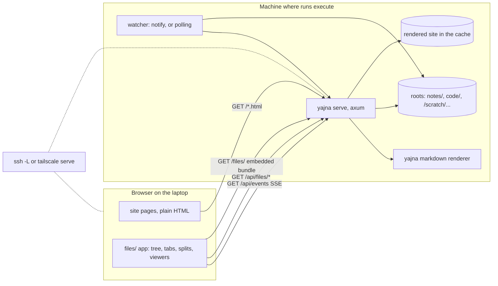

# The files viewer and `yajna serve`

Status: design v0.1, 2026-10-23, nothing built yet. Companion to `architecture.md`
(sections 6 and 11). Decisions: ADR-0027 (`yajna serve`), ADR-0028 (what the viewer shows
and how it stays live), ADR-0029 (the frontend). Experiments: section 10.

## 1. What it is for

Runs execute on a server (a GPU node, a cluster login node, a lab workstation) and write
what they produce beside the code or to scratch storage: logs that grow for hours, metric
files, checkpoints, images, many megabytes to many gigabytes. Agents run there too. Today
the way to see what they are doing is to SSH in and `tail`, `ls` and copy files back. The
static site shows the pages agents write, but nothing of the files around them.

The files viewer is a section of the site, `files/`, that shows the directories on the
disk of the machine `yajna serve` runs on, **live**: a tree of the configured roots, files
opening in tabs, tabs splitting into side-by-side groups the way VS Code's editor groups
do, logs that follow as they grow, and new files that appear in the tree as runs write
them. It is read-only. It looks like an IDE because that is the layout people already
know for "many files, a few open at once"; it is kept clean: a tree, the editor area and a
status line, no activity bar, no panels that do nothing yet.

The section is called *files*, not *assets*, because `assets/` is already a directory with
a narrower meaning (ADR-0020).

## 2. Decisions at a glance

| Question | Decision | Record |
|---|---|---|
| Static or live | The existing pages stay a static export (`yajna site`); `files/` exists only when served, and reads the disk on each request | 0027 |
| Command | `yajna serve` serves the rendered site, re-rendered when pages change, plus `files/` and its API, on one port; `yajna site --serve` becomes its alias | 0027 |
| Server stack | axum on tokio, in a new library crate `tools/yajna-serve`, with `tools/` made a Cargo workspace; the CLI links it, one binary | 0027 |
| Reaching it | Binds `127.0.0.1`; reached through `ssh -L` or `tailscale serve` (`--host <name>` accepts the tunnel's name); no auth in yajna; no `--bind` until there is a token | 0027 |
| JavaScript | Allowed in `files/` only; every other page stays plain HTML without scripts (amends ADR-0019) | 0027 |
| What it shows | Named roots from `yajna.toml`, inside or outside the repo; by default the vault and `code/` | 0028 |
| Filtering | Everything on disk except `.git` and the configured `exclude` patterns; no `.gitignore` | 0028 |
| Symlinks | Followed, including out of a root; loops detected | 0028 |
| Listing | Lazy, one directory per request, paginated | 0028 |
| Live | Filesystem watch (notify) on open directories and files, pushed over SSE; polling where watching does not work | 0028 |
| Layout | dockview-core | 0029 |
| Text and code | CodeMirror 6, read-only; a paged byte-range view above a size cap; follow mode for growing files | 0029 |
| Markdown | Rendered by yajna's own renderer with links and citations resolved, with a toggle to source | 0029 |
| Images | `` with @panzoom/panzoom | 0029 |
| Frontend build | TypeScript bundled by esbuild through Nix (`nix run .#ui`); the bundle is committed and embedded with rust-embed; a flake check fails when it is stale | 0029 |

## 3. Shape



`yajna serve` is one process. Before answering a page request it re-renders the static
site when a page changed since the last render (what `site --serve` does today); requests
under `/files/` and `/api/` never touch the index.

## 4. Configuration

```toml
[files]
exclude = ["node_modules", "*.tmp"]     # names or globs, in every root, on top of .git

[[files.roots]]
name = "notes"
path = "notes"

[[files.roots]]
name = "code"
path = "code"

[[files.roots]]
name = "scratch"
path = "/scratch/$USER/runs"            # absolute, ~ and $VARS expanded
exclude = ["*.ckpt"]                    # per root, added to the global list
watch = "poll"                          # auto (default) | poll | off
```

- Without a `[files]` table the roots are the vault, named `notes`, and `code/` when it
  exists, named `code`. In a `project` repo, where the code is the repository itself, the
  second default root is the repository root, named after the namespace, with the vault
  excluded so it is not listed twice.
- Root names are the first segment of every path the viewer uses (`scratch/run-17/log.txt`),
  so a URL or a saved layout survives the root moving on disk.
- `exclude` matches a path's file name or, with a `/`, its path below the root (globset
  syntax; a leading `/` anchors it at the root, as `/notes` does for the default
  repository root). `.git` is always excluded. Nothing reads `.gitignore`: the viewer shows what is
  on disk, which is the point of looking at a run's output.
- A root that does not exist is shown greyed with the reason (scratch not mounted), not an
  error that stops the server.
- `yajna validate` checks the table's shape; whether paths exist is the server's business,
  because they differ per machine.

## 5. The server: `tools/yajna-serve`

### 5.1 Crate and workspace

`tools/Cargo.toml` becomes a workspace with members `yajna` and `yajna-serve` and one
`Cargo.lock`. `yajna-serve` is a library: the axum router, the file API, the watcher, the
embedded UI bundle. It does not depend on `yajna`; the CLI passes what the server needs
from the notebook in a `ServeConfig`:

- the roots and excludes, already parsed from `yajna.toml`;
- the static site directory and a `render_site()` callback with a staleness check;
- a `render_markdown(path, text) -> html` callback, so the markdown preview uses the same
  renderer, `[[link]]` resolution and citations as the site.

That keeps the dependency one way (the CLI knows the notebook, the server knows HTTP and
files) and lets the Phase 3 server (HTTP write API, MCP) grow in the same crate with the
same callback pattern. tokio runs only inside `yajna serve`; every other command stays
synchronous. The `flake.nix` package builds the workspace and still produces one `yajna`
binary.

### 5.2 Routes

| Route | Returns |
|---|---|
| `GET /`, `GET /<page>.html` | the static site, as today |
| `GET /files/`, `GET /files/assets/*` | the embedded UI |
| `GET /api/files/roots` | `[{name, path, exists, watch}]` |
| `GET /api/files/list?path=<root>/<dir>&cursor=<n>` | one page (500) of a directory: `{path, total, entries: [{name, kind, size?, mtime?, link?}], next?}`, directories first, then by name; `mtime` in milliseconds |
| `GET /api/files/stat?path=` | `{path, kind, size?, mtime?, mime, text: bool, link?}` |
| `GET /api/files/raw?path=` | the bytes, with `Range`, `ETag` (size and mtime) and `If-None-Match` |
| `GET /api/files/render?path=` | rendered HTML for a markdown file |
| `GET /api/events?watch=<path>&watch=…` | SSE: `changed {path, size, mtime}`, `created`, `removed`, `listing {path}` |

Everything is `GET`; there is no route that writes. The client opens a new event stream
when the set of open files and expanded directories changes, which is rare and cheap, so
there is no subscription protocol.

### 5.3 Paths and safety

- A request path is `<root>/<rest>`. `<rest>` is split on `/`; empty, `.` and `..`
  segments are rejected before anything touches the disk, and each segment is joined
  onto the root's path. Symlinks met on the way are followed (ADR-0028), so a symlink
  inside a root can lead anywhere, but a URL can only name what is reachable by walking
  down from a root.
- Symlink loops are caught by tracking the (device, inode) pairs of the directories on
  the way down; a link back into its own ancestry is listed with `kind: loop` and not
  entered.
- The server rejects requests whose `Host` header is not `localhost`, `127.0.0.1`, `[::1]`
  or the `--host` names configured for a tunnel, which stops a web page in the same
  browser reaching the server through DNS rebinding. No CORS headers are sent.
- `raw` sends `Content-Type` from the extension, `X-Content-Type-Options: nosniff`, and
  `Content-Security-Policy: sandbox` on anything that is not an image, so an HTML or SVG
  file from a run can be looked at without running as part of the viewer.

### 5.4 Listing

A directory is read whole (`readdir` plus `stat` per entry), sorted, and its names and
kinds cached by (path, mtime); sizes and times are read again for the 500 entries of each
page, because a file being written changes them without touching its directory. Pages of
500 are handed out by offset, so a directory of 100 000 checkpoints opens with
its first page and the tree loads more on scroll. Entry kinds: `dir`, `file`, `broken`
(a symlink to nothing), `loop` (a symlink to a directory above it), `other` (sockets,
fifos, devices); a symlink has the kind of what it points to and its target as `link`. Whether a
file is text is decided on `stat` and `raw`, not in listings: the first 8 KB are read,
and it is text when they hold no NUL byte and decode as UTF-8 (a cut multi-byte sequence
at the end allowed). Experiment `EXP-20261023-kjtach` measures where this stops being
fast.

### 5.5 Live updates

- The watcher (`notify`, inotify on Linux, FSEvents on macOS) watches only what clients
  ask for: each open file's directory and each expanded directory, non-recursively. That
  stays far below inotify's per-user watch limit however big the roots are.
- Events are debounced (250 ms) and coalesced per path before they go out over SSE, so a
  log written line by line produces a few `changed` events a second, not thousands.
- `watch = "auto"` uses notify unless the root sits on a filesystem where events from
  other machines are not delivered (NFS, Lustre, GPFS, SMB, found with `statfs` on Linux).
  Then, and with `watch = "poll"`, the server polls the watched paths' size and mtime
  every 2 s. `watch = "off"` sends nothing; the UI shows a refresh button.
  `EXP-20261023-kjtrwp` checks this on the storage runs really write to.
- SSE carries a heartbeat every 15 s so that tunnels and proxies keep the connection.

## 6. The frontend: `tools/yajna-serve/ui`

### 6.1 Layout

```text
┌ notebook · files ─────────────────────────────────────────────┐
│ ▾ notes      │ run.sh  train.log ● ×   │ loss.png ×            │
│   ▸ projects │ ─────────────────────── │ ───────────────────── │
│ ▾ code       │  1 #!/usr/bin/env bash  │                       │
│   ▾ g2a      │  2 set -euo pipefail    │      [ image ]        │
│     run.sh   │  …                      │                       │
│ ▸ scratch    │                         │                       │
├──────────────┴─────────────────────────┴───────────────────────┤
│ code/g2a/train.log · 1.2 GB · following · utf-8 · ln 18 220    │
└────────────────────────────────────────────────────────────────┘
```

- **Tree** on the left: roots at the top level, lazily expanded, live. A filter box
  narrows the loaded entries by name; finding a file anywhere in the roots (quick open)
  needs a server-side index and is later.
- **Editor area**: dockview groups with tabs. A single click opens a *preview* tab (in
  italics) that the next single click replaces; a double click, or scrolling in it, keeps
  it. Splitting is by dragging a tab to an edge, or `Ctrl-\`. Tabs show a dot when their
  file changed on disk since it was opened.
- **Status line**: the focused file's path, size, mtime, encoding, cursor line, and
  whether it is following.
- Light and dark follow `prefers-color-scheme`; dockview and CodeMirror are themed from
  the same CSS variables as the site's pages.
- The site's nav gets a *files* link when it is rendered for `yajna serve`, and not in a
  static export, where it would lead nowhere. Entity pages link the files they name (a
  run's `script`, an artifact's path, a project's `code`) to `files/#…` the same way.

### 6.2 State in the URL and the browser

- The URL hash names the focused file and an optional line range,
  `files/#code/g2a/run.sh:L12-30`, so a link to a line can be pasted into a log line or a
  chat message.
- The layout (groups, their tabs, sizes) is saved with dockview's `toJSON` in
  `localStorage` under the notebook's namespace, and restored on load; tabs whose file has
  gone are dropped.

### 6.3 Viewers

A viewer is a module with `matches(stat) -> score` and `open(container, file)`; the
registry picks the highest score, and the tab's menu offers the others (*open as text*,
*open as hex*). The first set:

| Viewer | Matches | Notes |
|---|---|---|
| Text | `text: true`, size up to the cap | CodeMirror 6, read-only, line numbers, highlighting by extension, in-file search, folding, line links. Follow mode on by default for `.log`, `.out`, `.err`, `.jsonl` and files that grew while open: appends with a `Range` request from the old size, keeps the view at the bottom unless scrolled up, reloads when the file shrank |
| Large text | `text: true`, above the cap | A paged view over `Range` requests in 256 KB windows, with a byte-offset scrollbar, *jump to end* and follow; no highlighting, search within the loaded window. The cap starts at 20 MB; `EXP-20261023-kjv5wy` sets it |
| Markdown | `.md` | Rendered through `/api/files/render`, so `[[ID]]` links to entity pages and citations work; a toggle flips to the text viewer. A page with a yajna `id` gets a link to its entity page |
| Image | png, jpg, gif, webp, avif, bmp, ico, svg | `` from `raw`, wheel and pinch zoom with @panzoom/panzoom, fit and 1:1; SVG as an image, never inline. Reloads on change, so a plot that a run rewrites updates |
| Binary | everything else | Size, mtime, type, a download link, *open as text* and *open as hex* (the first 64 KB) |

Later, as needed: PDF in the browser's own viewer (an `<iframe>`), CSV and TSV as a table
with a row cap (and `results.tsv` with the run columns linked), JSON with folding (it is
text already), notebooks (`.ipynb`), TIFF and other microscopy formats converted
server-side or tiled for OpenSeadragon, and HDF5 or Parquet summaries. Each is a new
module in the registry and, where the browser cannot read the format, a server route.

### 6.4 Building it

- Source is TypeScript under `tools/yajna-serve/ui/src`, with `package.json` and
  `package-lock.json` pinning dockview-core, CodeMirror (`@codemirror/view`, `state`,
  `language`, `search`, and the language packages) and @panzoom/panzoom.
- `nix run .#ui` builds it with esbuild from the locked npm dependencies (through Nix, no
  global Node) into `tools/yajna-serve/ui/dist/`: one JS file, one CSS file, the HTML
  shell. `dist/` is committed, so `cargo build` needs no Node and the release workflow
  does not change.
- `rust-embed` includes `dist/` in the binary. A flake check rebuilds the bundle and fails
  if it differs from what is committed, and `tsc --noEmit` type-checks the source.
- The budget is about 350 KB gzipped for the whole bundle; `EXP-20261023-kjv5wy` measures
  it and the binary growth from axum and tokio.

## 7. What it does not do

- **Edit, delete, upload or run anything.** Writes come with the Phase 3 API and its auth,
  if ever for files.
- **Search inside files or across the roots.** Quick open by name and full-text search
  need an index of the roots; later, and `qmd` already searches the vault.
- **Show git state.** No diffs, blame or history; a dirty marker per file could come later
  from `git status`.
- **Authenticate.** It relies on binding to loopback and on the tunnel. A shared machine
  where other users can open a loopback port needs the token (ADR-0027), which is not
  built.

## 8. Build order

Each step lands with its tests and is usable on its own.

| Step | Build | Verify |
|---|---|---|
| 1 | The workspace; `yajna-serve` with axum serving the rendered site and re-rendering it when stale; `yajna serve`, `site --serve` as its alias; the old hand-rolled server removed | The site tests pass against the new server; the binary still builds through Nix and for the release targets |
| 2 | `[files]` in `yajna.toml` and its validation; `roots`, `list`, `stat`, `raw` with ranges; path and Host checks | Integration tests on a temporary tree: traversal, symlink out and loop, a 100 000-entry directory, ranges, an excluded path, a missing root |
| 3 | The UI: shell, tree, dockview, the text, markdown, image and binary viewers; `nix run .#ui`, the committed bundle, the staleness check; the *files* link in the served site and from entity pages | Opening, previewing, pinning, splitting and deep links by hand on this repo; a headless browser test for the tree and a tab |
| 4 | Watch and SSE, polling, follow mode, the changed-tab dot | A script appending to a log and writing an image; the tab follows, the tree shows the new file within a second (`watch = auto`) or three (`poll`) |
| 5 | The large-text viewer and the cap | A 5 GB log opens at its end in under a second and follows |
| 6 | Viewers as they are needed | Per viewer |

## 9. Risks

- **Watching across machines.** A run on a cluster node writing to shared storage that the
  server watches from the login node produces no inotify events there. Polling covers it;
  detecting the filesystem decides when to poll (`EXP-20261023-kjtrwp`).
- **Huge directories.** Reading and sorting a million entries before the first page costs
  seconds and memory. If it does, listings become unsorted and streamed for directories
  over a threshold (`EXP-20261023-kjtach`).
- **Bundle drift.** A committed bundle can disagree with its source; the flake check is the
  guard.
- **Binary size and compile time.** axum, tokio, notify and the embedded bundle add to a
  binary that machines without Nix download; measured in `EXP-20261023-kjv5wy`.

## 10. Experiments

- `EXP-20261023-kjtach`: listing and reading at the scale of real run output.
- `EXP-20261023-kjtrwp`: whether watching sees what runs write, on the storage they write
  to.
- `EXP-20261023-kjv5wy`: the largest file the text viewer opens smoothly, the bundle size
  and the binary growth.
- `EXP-20261023-kjvkas`: the verification: ank follows an agent's run on a remote machine
  from the laptop without opening a shell there.
