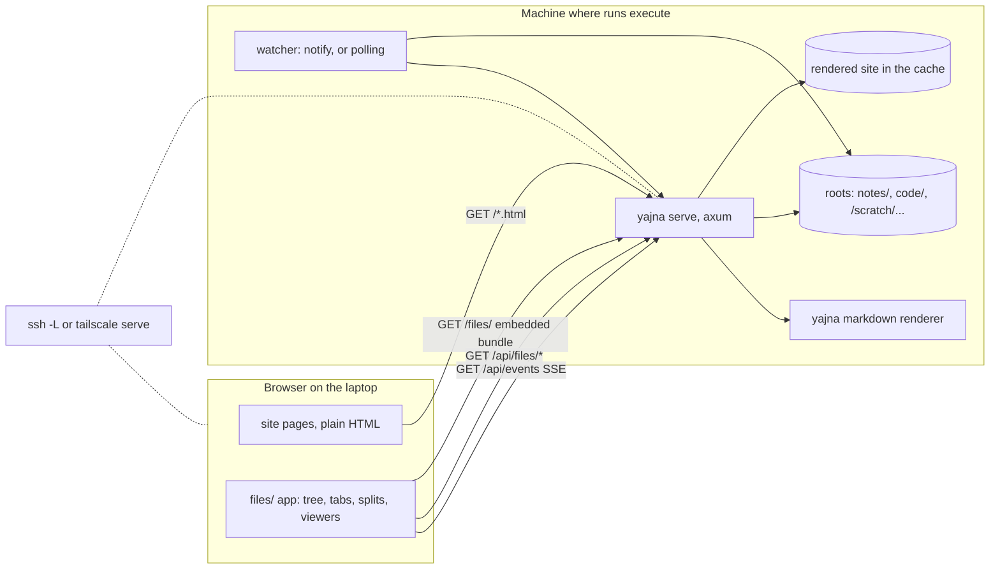

# The files viewer and `yajna serve`

Status: design v0.3, 2026-10-24; steps 1 to 4 built (yajna 0.8.0). Companion to
`architecture.md` (sections 6 and 11). Decisions: ADR-0027 (`yajna serve`), ADR-0028
(what the viewer shows and how it stays live), ADR-0029 (the frontend). Experiments:
section 10.

## 1. What it is for

Runs execute on a server (a GPU node, a cluster login node, a lab workstation) and write
what they produce beside the code or to scratch storage: logs that grow for hours, metric
files, checkpoints, images, many megabytes to many gigabytes. Agents run there too. Today
the way to see what they are doing is to SSH in and `tail`, `ls` and copy files back. The
static site shows the pages agents write, but nothing of the files around them.

The files viewer is a section of the site, `files/`, that shows the directories on the
disk of the machine `yajna serve` runs on, **live**: a tree of the configured roots, files
opening in tabs, tabs splitting into side-by-side groups the way VS Code's editor groups
do, logs that follow as they grow, and new files that appear in the tree as runs write
them. It is read-only. It looks like an IDE because that is the layout people already
know for "many files, a few open at once"; it is kept clean: a tree, the editor area and a
status line, no activity bar, no panels that do nothing yet.

The section is called *files*, not *assets*, because `assets/` is already a directory with
a narrower meaning (ADR-0020).

## 2. Decisions at a glance

| Question | Decision | Record |
|---|---|---|
| Static or live | The existing pages stay a static export (`yajna site`); `files/` exists only when served, and reads the disk on each request | 0027 |
| Command | `yajna serve` serves the rendered site, re-rendered when pages change, plus `files/` and its API, on one port; `yajna site --serve` becomes its alias | 0027 |
| Server stack | axum on tokio, in a new library crate `tools/yajna-serve`, with `tools/` made a Cargo workspace; the CLI links it, one binary | 0027 |
| Reaching it | Binds `127.0.0.1`; reached through `ssh -L` or `tailscale serve` (`--host <name>` accepts the tunnel's name); no auth in yajna; no `--bind` until there is a token | 0027 |
| JavaScript | Allowed in `files/` only; every other page stays plain HTML without scripts (amends ADR-0019) | 0027 |
| What it shows | Named roots from `yajna.toml`, inside or outside the repo; by default the vault and `code/` | 0028 |
| Filtering | Everything on disk except `.git` and the configured `exclude` patterns; no `.gitignore` | 0028 |
| Symlinks | Followed, including out of a root; loops detected | 0028 |
| Listing | Lazy, one directory per request, paginated | 0028 |
| Live | Filesystem watch (notify) on open directories and files, pushed over SSE; polling where watching does not work | 0028 |
| Layout | One web app for the notebook: a sidebar with the notebook, its worktrees and sections; a page per directory, file, diff or review; a drawer on a phone | 0041 |
| Text and code | CodeMirror 6, read-only, loaded when a file opens; above 4 MB the last 1 MB; growing files followed by appending `Range` reads | 0029, 0041 |
| Markdown | Rendered by yajna's own renderer with links and citations resolved | 0029 |
| Images | `` fitted to the width, drawn again when rewritten | 0041 |
| Video | `<video>` with controls from `raw`, which answers byte ranges for seeking; a video in markdown's image syntax is a player too | 0041 |
| Mermaid | ` ```mermaid ` blocks in rendered markdown drawn by mermaid (`securityLevel: strict`), split into chunks loaded only when a page has one | 0041 |
| Frontend build | React in TypeScript, bundled by esbuild through Nix (`nix run .#web`); the bundle is committed and embedded with rust-embed; a flake check fails when it is stale | 0041 |

## 3. Shape



`yajna serve` is one process. Before answering a page request it re-renders the static
site when a page changed since the last render (what `site --serve` does today); requests
under `/files/` and `/api/` never touch the index.

## 4. Configuration

```toml
[files]
exclude = ["node_modules", "*.tmp"]     # names or globs, in every root, on top of .git

[[files.roots]]
name = "notes"
path = "notes"

[[files.roots]]
name = "code"
path = "code"

[[files.roots]]
name = "scratch"
path = "/scratch/$USER/runs"            # absolute, ~ and $VARS expanded
exclude = ["*.ckpt"]                    # per root, added to the global list
watch = "poll"                          # auto (default) | poll | off
```

- Without a `[files]` table the roots are the vault, named `notes`, and `code/` when it
  exists, named `code`. In a `project` repo, where the code is the repository itself, the
  second default root is the repository root, named after the namespace, with the vault
  excluded so it is not listed twice.
- Root names are the first segment of every path the viewer uses (`scratch/run-17/log.txt`),
  so a URL or a saved layout survives the root moving on disk.
- `exclude` matches a path's file name or, with a `/`, its path below the root (globset
  syntax; a leading `/` anchors it at the root, as `/notes` does for the default
  repository root). `.git` is always excluded. Nothing reads `.gitignore`: the viewer shows what is
  on disk, which is the point of looking at a run's output.
- A root that does not exist is shown greyed with the reason (scratch not mounted), not an
  error that stops the server.
- `yajna validate` checks the table's shape; whether paths exist is the server's business,
  because they differ per machine.

## 5. The server: `tools/yajna-serve`

### 5.1 Crate and workspace

`tools/Cargo.toml` becomes a workspace with members `yajna` and `yajna-serve` and one
`Cargo.lock`. `yajna-serve` is a library: the axum router, the file API, the watcher, the
embedded UI bundle. It does not depend on `yajna`; the CLI passes what the server needs
from the notebook in a `ServeConfig`:

- the roots and excludes, already parsed from `yajna.toml`;
- the static site directory and a `render_site()` callback with a staleness check;
- a `render_markdown(path, text) -> html` callback, so the markdown preview uses the same
  renderer, `[[link]]` resolution and citations as the site.

That keeps the dependency one way (the CLI knows the notebook, the server knows HTTP and
files) and lets the Phase 3 server (HTTP write API, MCP) grow in the same crate with the
same callback pattern. tokio runs only inside `yajna serve`; every other command stays
synchronous. The `flake.nix` package builds the workspace and still produces one `yajna`
binary.

### 5.2 Routes

| Route | Returns |
|---|---|
| `GET /`, `GET /<page>.html` | the static site, as today |
| `GET /files/`, `GET /files/assets/*` | the embedded UI |
| `GET /api/files/roots` | `[{name, path, exists, watch}]` |
| `GET /api/files/list?path=<root>/<dir>&cursor=<n>` | one page (500) of a directory: `{path, total, entries: [{name, kind, size?, mtime?, link?}], next?}`, directories first, then by name; `mtime` in milliseconds |
| `GET /api/files/stat?path=` | `{path, kind, size?, mtime?, mime, text: bool, link?}` |
| `GET /api/files/raw?path=` | the bytes, with `Range`, `ETag` (size and mtime) and `If-None-Match` |
| `GET /api/files/render?path=` | rendered HTML for a markdown file |
| `GET /api/events?watch=<path>&watch=…` | SSE: `changed {path, size, mtime}`, `created`, `removed`, `listing {path}` |
| `GET /api/reviews`, `GET /api/reviews/<ID>`, `GET /api/reviews/<ID>/file?path=&old=` | reviews, one review with its threads, changed files and `version`, a changed file at base and head (`docs/review.md` 7.2) |
| `POST /api/reviews/<ID>/<action>` | with `yajna serve --review` only: a token, a matching `Origin` and the page's `version` |
| `GET /`, `/p/<ID>`, `/c/<type>`, `/log`, `/tasks`, `/search?q=`, `/reviews`, `/changes`, `/files/…`; `/assets/*` | the web app (ADR-0041) and its files; it works out its base from its own address. Without notebook pages (`dir_router`) `/` is not served. The static site's pages stay at `/<ID>.html`, the classic viewer at `/classic/` |
| `GET /api/notebook` | the overview: `{namespace, shape, projects: [summary + experiments, runs, phases: {done, total, active}, needs, worktree?], collections: [{type, label, count}], recent, tasks_open}`; a project worked on in a worktree of its own is counted there (`worktree`), and its lines are merged into `recent` (ADR-0043) |
| `GET /api/pages?type=&project=`, `GET /api/pages/<ID>` | pages newest first, each a summary (`id, type, title, status, outcome, kind, project, experiment, created, author, tags`, and `note`, the line its parent gives it); one page with `path`, `html` (yajna's renderer, raw HTML as text), `fields` (`{key, value, ids, file}`), a project's `phases`, `experiments` and `tree`, an experiment's `runs: {columns, rows}`, `backlinks` and `log` |
| `GET /api/log?skip=&limit=`, `GET /api/tasks?done=` | `{total, entries}` newest first, with each project's lines from its own worktree merged in, those marked `scope` and `worktree` (ADR-0043); the checkboxes with their page |
| `GET /api/search?q=&limit=` | the pages with every word of `q` in their ID, title, tags or body, ignoring case, best first (an ID over a title over a tag over the body; the whole query as the ID or title above all), `limit` (50) of them as summaries with `snippet`, the passage with the first word as plain text; and the log lines with every word, the newest 20: `{pages, pages_total, log, log_total}` |
| `GET /api/worktrees` | every worktree of the notebook (ADR-0039): `{worktrees: [{name, branch, path, head, current, url, changed, staged, untracked, conflicted}]}`, `name` the branch or `@<short sha>`, `url` relative to the notebook's address |
| `/w/<branch>/…` | everything above, for that worktree, the branch percent-encoded (`/w/lab%2Ftopic/files/`); opened on its first request, dropped when the worktree goes; `/w/<branch>` redirects to the slash form |
| `GET /api/projects` | a lab's projects as scopes (ADR-0043): `{projects: [{id, slug, title, status, folders: [{label, path}], url, home, worktrees: [worktree + home, ahead]}], others: [worktrees of no project]}`; a project's worktrees are those on `<slug>/…`, its `home` the one on `<slug>/main`, else the one committed to last; `ahead` counts commits not in the served checkout. 404 in a `project` notebook or with `[serve] worktrees = "this"` |
| `/project/<slug>/…`, `/project/<slug>/w/<branch>/…` | everything above, for one project, from its home worktree (or the named one of its own, or the served checkout); the pages API answers for the project: lists, log, tasks and search filtered (a page belongs by its `project`, or by its links when it has none; a log line by the pages it names, a line naming none only under *All projects*; protocols, materials and equipment listed as lab-wide), `/api/notebook` the project's home with `scope`, `needs` (drafts and `review: pending` pages) and its folders, `/api/search` with `outside: {pages, log}` |
| `GET /api/git/status?path=<root>/<dir>` | the worktree the path is in (ADR-0038): `{worktree, branch, head, upstream, ahead, behind, unstaged, staged, untracked, conflicted}`, each change `{rel, path, status, old?}`, `rel` below the worktree's top and `path` where a root shows it (`null` when none does) |
| `GET /api/git/log?path=&before=&limit=` | commits newest first, 30 a page: `{commits: [{sha, short, author, time, parents, subject, files}], next?}`; a directory's log has the commits that touched it |
| `GET /api/git/diff?path=<file>&from=&to=&old=` | `{diff, binary, truncated}`, a unified diff of one file from `from` (default `HEAD`) to `to` (default `WORK`), each `HEAD`, `INDEX`, `WORK` or a commit with an optional `^`; an untracked file shows as added, `old` gives a rename's other side |
| `GET /api/git/file?path=&at=` | the file as it was at `at` (default `HEAD`) |
| `POST /api/git/stage`, `POST /api/git/unstage` `{path, old?, hunk?}` | ADR-0040: stage or unstage a file, or one hunk by the `id` the diff's `hunks` gave it (409 when that hunk changed or went); an untracked file is staged whole; the worktree's status after |
| `POST /api/git/commit` `{path, message, tree}` | commit what is staged when its tree is still the `tree` the status gave (409 otherwise), as git is configured on the machine, hooks run (422 with their words when one refuses); `{commit, status}` |

Everything is `GET` except the review writes and the three git writes, which exist only
behind `--review` or on the owner's socket. The git routes run the `git` CLI with optional locks off; the three git writes pass the review
writes' check (the owner's socket, or `--review`'s token and `Origin`) and are refused
everywhere else, `dir_router` and `git::router` included. The read routes take paths by the rules of 5.3 (a deleted
file's path is resolved through its directory, never past an exclusion), and need only the
roots: `yajna_serve::git::router(roots)` serves them alone, and
`yajna_serve::dir_router(roots, render, version)` serves them with the viewer and its changes
view over a directory of its own, without a site, reviews or worktree list, as saarthi's
node does for a session's directory. The client opens a new event stream
when the set of open files and expanded directories changes, which is rare and cheap, so
there is no subscription protocol.

### 5.3 Paths and safety

- A request path is `<root>/<rest>`. `<rest>` is split on `/`; empty, `.` and `..`
  segments are rejected before anything touches the disk, and each segment is joined
  onto the root's path. Symlinks met on the way are followed (ADR-0028), so a symlink
  inside a root can lead anywhere, but a URL can only name what is reachable by walking
  down from a root.
- Symlink loops are caught by tracking the (device, inode) pairs of the directories on
  the way down; a link back into its own ancestry is listed with `kind: loop` and not
  entered.
- The server rejects requests whose `Host` header is not `localhost`, `127.0.0.1`, `[::1]`
  or the `--host` names configured for a tunnel, which stops a web page in the same
  browser reaching the server through DNS rebinding. No CORS headers are sent.
- `raw` sends `Content-Type` from the extension, `X-Content-Type-Options: nosniff`, and
  `Content-Security-Policy: sandbox` on anything that is not an image, so an HTML or SVG
  file from a run can be looked at without running as part of the viewer.

### 5.4 Listing

A directory is read whole (`readdir` plus `stat` per entry), sorted, and its names and
kinds cached by (path, mtime); sizes and times are read again for the 500 entries of each
page, because a file being written changes them without touching its directory. Pages of
500 are handed out by offset, so a directory of 100 000 checkpoints opens with
its first page and the tree loads more on scroll. Entry kinds: `dir`, `file`, `broken`
(a symlink to nothing), `loop` (a symlink to a directory above it), `other` (sockets,
fifos, devices); a symlink has the kind of what it points to and its target as `link`. Whether a
file is text is decided on `stat` and `raw`, not in listings: the first 8 KB are read,
and it is text when they hold no NUL byte and decode as UTF-8 (a cut multi-byte sequence
at the end allowed). Experiment `EXP-20261023-kjtach` measures where this stops being
fast.

### 5.5 Live updates

- **One stream per page.** `GET /api/events?watch=<path>&watch=…` names the open files and
  expanded directories; the page opens a new stream, 300 ms after the set last changed,
  whenever a tab opens or closes or a directory is expanded or collapsed. On connecting,
  the server sends every path's current state, so nothing that changed between the page
  loading and subscribing is missed, and EventSource's own reconnection is safe.
- **One `change` event shape**: `{path, kind: file|dir, exists, size?, mtime?}`.
- **Change is decided by comparison.** A file has changed when its existence, size or
  mtime differs from what was last sent, a directory when its existence or mtime does.
  Filesystem events only say when to look, so a missed or spurious event costs latency,
  never a wrong update.
- **When to look.** The watcher (`notify`: inotify on Linux, FSEvents on macOS) watches
  only each open file's directory and each expanded directory, non-recursively, far below
  inotify's per-user limit however big the roots are; its events are debounced 250 ms.
  Open files are also looked at every second, because macOS reports writes to a file a
  process keeps open (a run's log) only when it is closed (`RUN-20261024-p44p6z`).
  Directories in poll mode are looked at every 2 s, and everything every 30 s in case an
  event was lost. A path the watcher cannot take (out of watches) falls back to polling.
- **`watch = "auto"`** uses notify unless the path sits on a filesystem where events from
  other machines do not arrive: by `statfs` type on Linux (NFS, SMB/CIFS, Lustre, GPFS,
  BeeGFS, Ceph, AFS, 9p, FUSE), by the absence of `MNT_LOCAL` on macOS. Then, and with
  `watch = "poll"`, it polls. `watch = "off"` sends a path's state once and nothing after.
  `/api/files/roots` reports what each root gets as `live`.
- **Measured on the laptop** (APFS): an append reaches the page in 266 ms through events
  and 0.5 s polled; a log written through one open handle updates about once a second.
  The cluster's shared storage is still to measure (`EXP-20261023-kjtrwp`).
- SSE carries a heartbeat every 15 s so that tunnels and proxies keep the connection.

## 6. The frontend: `tools/yajna-serve/web`

Until 0.40.0 this was a workbench of its own (ADR-0029): a tree, dockview tabs and splits,
viewers in a registry, a side-by-side review diff. ADR-0041 replaced it with one React app
for the whole notebook, the same on a phone and a desktop; the files are one of its
sections. What follows describes the app's files, changes and review screens.

### 6.1 Layout and state

- **Sidebar**: the notebook, the scope switcher in a lab (ADR-0043: *All projects*, or a
  project shown from its own worktree, its other worktrees under it and the worktrees of
  no project after them) or the worktree picker elsewhere (ADR-0039), the sections
  (overview, log, tasks, changes, files, reviews), the projects (each opening as its scope)
  and the page types, lab-wide ones apart in a scope; on a phone it is a drawer behind the
  top bar's menu button, and the top bar names the scope.
- **A project's home**: in a scope the overview is the project's: its counts, its phases,
  *Needs you* (draft conclusions and pages under `review: pending`), its folders and its
  latest lines. Under *All projects* each card says where its project is worked on, how far
  ahead and how much is uncommitted; a page or a file of a project whose worktree is ahead
  of the served checkout says so and links to the current one.
- **Files**: in a scope its project's folders first, under *All projects* each project's
  folders (opening in its scope), then the roots; then a directory a page of 500 at a time, then a file; a
  breadcrumb goes back up. The address names the file (`files/<root>/<path>`), so links
  can be pasted; `files/#<root>/<path>`, the previous viewer's form, is turned into it.
- **Loading**: every read goes through a cache that shows what it last had while it reads
  again; skeletons stand where nothing is known yet; a thin bar shows only after 300 ms; a
  server that cannot be reached is asked again with backoff and one *Reconnecting…* line.

### 6.2 Viewers

| Files | Shown as |
|---|---|
| Markdown | Rendered through `/api/files/render`, so `[[ID]]` links and citations work and open in the app |
| Images | `` from `raw`, fitted to the width, drawn again when the file is rewritten |
| Video (`.mp4`, `.m4v`, `.webm`, `.mov`, `.ogv`) | `<video>` with controls from `raw`, seeking by byte ranges |
| Text up to 4 MB | CodeMirror 6, read-only, line numbers, highlighting by extension (the language packages are chunks loaded when needed); logs (`.log`, `.out`, `.err`, `.jsonl`) open at their end |
| Text over 4 MB | Its last 1 MB from the first whole line, without line numbers (they would count from the tail), followed as it grows |
| Anything else | Size, type and a download link |

Live (5.5): the open file and directory are named in one `/api/events` stream. A file that
grew is appended with a `Range` read from the old size, and kept at the end when it was
there before the new lines came; a file that shrank or was rewritten in place is read
again. Not carried over from the workbench, for now: splits and tabs, the hex view, image
zoom, markdown's source toggle, search within a file.

### 6.3 The changes view

What is uncommitted, staged and recently committed (ADR-0038), in `web/src/changes.tsx`,
over `/api/worktrees` and `/api/git/`. It opens on the notebook's worktrees with how much is
uncommitted in each (straight to the one when there is only one), then a worktree's
conflicted, staged, changed and untracked files and its commits, 20 a page, a commit
opening its files; a file opens its unified diff in one column (staged: `HEAD` to
`INDEX`, changed: `INDEX` to `WORK`, untracked: added, a commit's: its parent to it), with
the old and new line numbers, long lines wrapped, and *Open file*. A file no root shows is
listed but not opened. It reads again every 4 s while it is shown. Where the viewer writes
(ADR-0040) it stages, unstages and commits, and a tapped range of lines takes a comment
that becomes a review thread.

### 6.4 Reviews

`web/src/review.tsx` (ADR-0041) reads `/api/reviews/<ID>` and its `file` route, which give
a file at two commits rather than a diff, and diffs them itself (`linediff.ts`, Myers'
algorithm, three lines of context; a pair of files over 25 million line pairs is shown as
all removed and all added). Threads are drawn under the line their anchor ends at, at the
commit shown (the head, a fix, or `work`). Writes are the same routes the CLI's
`Reviews::write` takes, each with the page's `version`.

### 6.5 Building it

- Source is TypeScript and React under `tools/yajna-serve/web/src`, with `package.json`
  and `package-lock.json` pinning React, TanStack Query, lucide icons and CodeMirror:
  libraries only, no build tools, installed with `--ignore-scripts`.
- `build.sh` type-checks with `tsc` and bundles with `esbuild`, both from nixpkgs, so no
  native npm binaries enter the lock file. `nix run .#web` runs it in the sandbox over the
  locked dependencies (`importNpmLock`) and copies the result into
  `tools/yajna-serve/web/dist/` (`index.html` and `assets/`). `dist/` is committed, so
  `cargo build` needs no Node and the release workflow does not change.
- `rust-embed` includes `dist/` in the binary. The flake check `web-bundle` rebuilds the
  bundle and fails if it differs from what is committed.
- `index.html` works out the app's base from its own address before anything loads and
  sets `<base>`, so the same files serve `/`, `/w/<branch>/`, `/n/<namespace>/` and a
  relay's path. The code view and each language are chunks loaded when first needed.

## 7. What it does not do

- **Edit, delete, upload or run anything.** Writes come with the Phase 3 API and its auth,
  if ever for files.
- **Search inside files or across the roots.** Quick open by name and full-text search
  need an index of the roots; later, and `qmd` already searches the vault.
- **Write to git.** ADR-0038 added a read-only view of git state, the `/api/git/` routes of
  5.2 and a changes view; staging, committing and blame are not built.
- **Authenticate.** It relies on binding to loopback and on the tunnel. A shared machine
  where other users can open a loopback port needs the token (ADR-0027), which is not
  built.

## 8. Build order

Each step lands with its tests and is usable on its own.

| Step | Build | Verify |
|---|---|---|
| 1 | The workspace; `yajna-serve` with axum serving the rendered site and re-rendering it when stale; `yajna serve`, `site --serve` as its alias; the old hand-rolled server removed | The site tests pass against the new server; the binary still builds through Nix and for the release targets |
| 2 | `[files]` in `yajna.toml` and its validation; `roots`, `list`, `stat`, `raw` with ranges; path and Host checks | Integration tests on a temporary tree: traversal, symlink out and loop, a 100 000-entry directory, ranges, an excluded path, a missing root |
| 3 | The UI: shell, tree, dockview, the text, markdown, image and binary viewers; `nix run .#ui`, the committed bundle, the staleness check; the *files* link in the served site and from entity pages | Opening, previewing, pinning, splitting and deep links by hand on this repo; a headless browser test for the tree and a tab |
| 4 | Watch and SSE, polling, follow mode, the changed-tab dot | A script appending to a log and writing an image; the tab follows, the tree shows the new file within a second (`watch = auto`) or three (`poll`) |
| 5 | The large-text viewer and the cap | A 5 GB log opens at its end in under a second and follows |
| 6 | Viewers as they are needed | Per viewer |

## 9. Risks

- **Watching across machines.** A run on a cluster node writing to shared storage that the
  server watches from the login node produces no inotify events there. Polling covers it;
  detecting the filesystem decides when to poll (`EXP-20261023-kjtrwp`).
- **Huge directories.** Reading and sorting a million entries before the first page costs
  seconds and memory. If it does, listings become unsorted and streamed for directories
  over a threshold (`EXP-20261023-kjtach`).
- **Bundle drift.** A committed bundle can disagree with its source; the flake check is the
  guard.
- **Binary size and compile time.** axum, tokio, notify and the embedded bundle add to a
  binary that machines without Nix download; measured in `EXP-20261023-kjv5wy`.

## 10. Experiments

- `EXP-20261023-kjtach`: listing and reading at the scale of real run output.
- `EXP-20261023-kjtrwp`: whether watching sees what runs write, on the storage they write
  to.
- `EXP-20261023-kjv5wy`: the largest file the text viewer opens smoothly, the bundle size
  and the binary growth.
- `EXP-20261023-kjvkas`: the verification: ank follows an agent's run on a remote machine
  from the laptop without opening a shell there.
