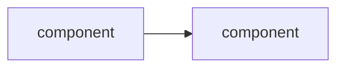

# $title: architecture

The design of the code for [[$id]]. Decisions with their alternatives are recorded one
per file in `decisions/`; this document says how the pieces fit and links them.

## Goals and constraints
What it must do, for whom, and what it must not do or depend on.

## Data model
The few nouns, their identities and lifetimes; what is the source of truth and what is
derived and rebuildable.

## Components
What runs where and what talks to what.

## Stack
Language, libraries and build, each with the reason (link the decision record).

## Phases
Each phase with its deliverable and the check that proves it worked. The project page's
*Progress* checklist tracks them.

## Open questions
Questions the design still rests on; the experiments that answer them.
